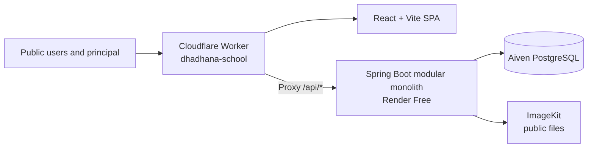
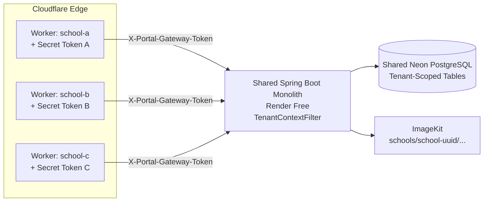

# Architecture — Rorfost School Platform

## Overview

Rorfost School Platform is a feature-oriented Spring Boot modular monolith with a React single-page frontend. This architecture provides simplicity and operational efficiency for small schools without distributed microservice overhead.

## Architecture: As-Is vs. Target

### Current Production State (As-Is)
A single-school production deployment serving Dhadhana Primary School:

- Public and admin controllers resolve the default school via `SchoolRepository.findFirstByIsActiveTrueOrderByCreatedAtAsc()`.
- Single database schema on Aiven PostgreSQL with Spring Session JDBC.
- Single ImageKit account with flat or mixed asset paths.

### Target Multi-Tenant State (Migration Plan)
A multi-tenant architecture hosting multiple schools on unified infrastructure:

- **Per-School Cloudflare Workers:** Each school has a distinct Worker host (`school-a.workers.dev`, etc.) serving the same SPA build with school-specific static routes and injecting an opaque, cryptographically random `PORTAL_GATEWAY_TOKEN` secret into proxied `/api/*` requests.
- **Render Backend Gateway Filter:** Intercepts `/api/*` calls, validates the SHA-256 token hash against the database, and binds an immutable `TenantContext` to the request thread.
- **Tenant Context Enforcement:** All controllers, services, and repositories filter queries and mutations by `school_id`. No entity is shared across tenants.
- **Neon PostgreSQL:** Single shared database with strict composite foreign keys, partial indexes, and tenant predicates.
- **ImageKit Namespace:** Objects stored with prefix `schools/<school-uuid>/...` to guarantee file ownership isolation.

## Components and Boundaries

- **Frontend:** React 19 / Vite static SPA with TanStack Query, React Router, Tailwind CSS, and Gujarati-first components.
- **Backend Packages:**
  - `auth`: Principal authentication, session restoration, and password management.
  - `school`: School settings, principal profile, and visitor counts.
  - `academic`: Academic years, standards, subjects, standard-subject mappings, and student rosters.
  - `assessment`: Annual and Ekam Kasoti exam results, marks calculations, and presentation rules.
  - `content`: Study materials, notices, photo gallery albums, and downloads.
  - `dashboard` & `audit`: Operational summary and append-only administrative logs.
  - `tenant` *(Target)*: Request-scoped tenant context holder and gateway verification filter.
  - `featureflag` *(Target)*: School-level feature registry and backend/frontend gatekeepers.
  - `common`: Cross-cutting security, exceptions, and ImageKit storage abstractions.

## Security Boundaries

1. **Origin Protection:** The backend does not trust unauthenticated incoming headers (`Host`, `Origin`, `X-Forwarded-Host`, `X-School-Id`) for tenant routing.
2. **Session-Tenant Binding:** Admin requests must satisfy `PrincipalSession.schoolId == TenantContext.schoolId`.
3. **Database Isolation:** Every sensitive query and join enforces tenant ownership.
4. **Result Privacy:** Public result lookups enforce `Cache-Control: no-store` and resist enumeration attacks.
