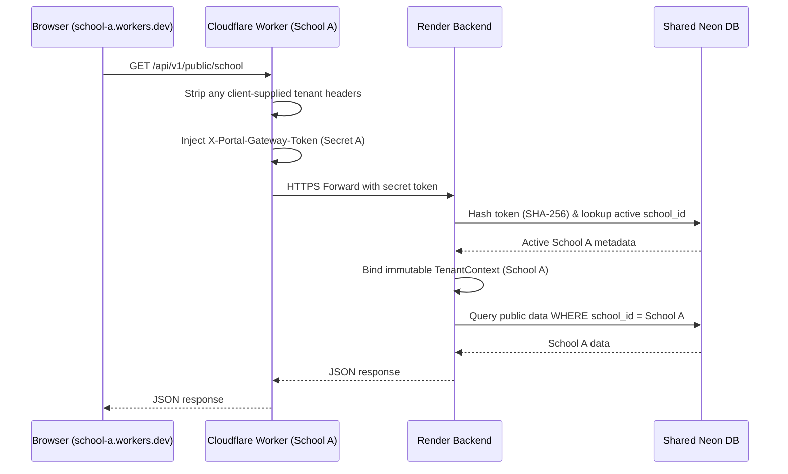
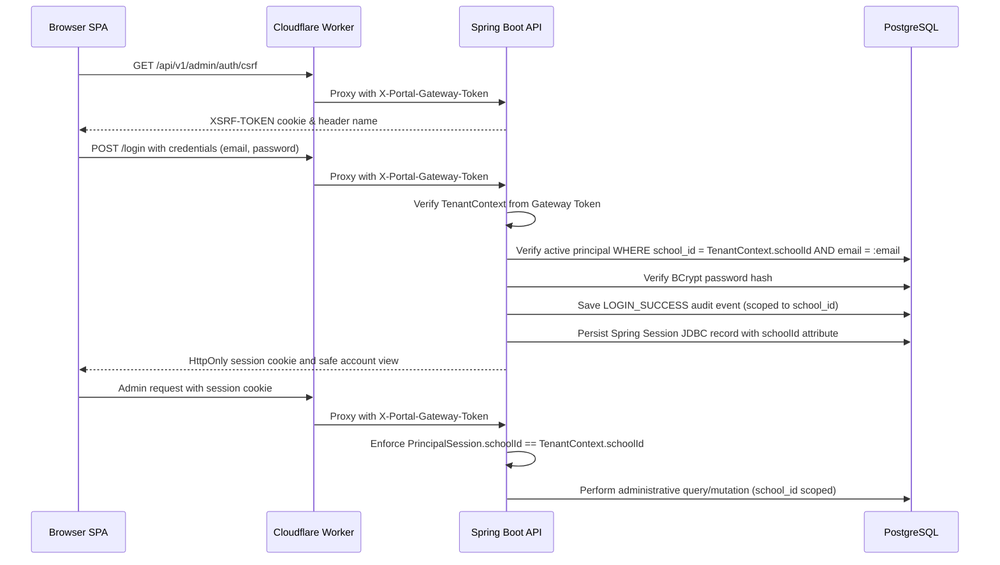
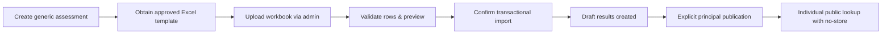

# Key Flows — Rorfost School Platform

## 1. Public Page Load and API Routing

### Current State (As-Is)
Browser visits `portal.dhadhana-school.workers.dev`; the single Cloudflare Worker serves the static React SPA and proxies `/api/*` directly to Render without tenant authentication tokens. The backend loads the first active school row.

### Target State (Multi-Tenant Plan)

## 2. Principal Login and Session Lifecycle

The server rotates the session ID at login and password change. Logout invalidates the JDBC session. In the target multi-tenant model, authenticating at School A's portal cannot grant access to School B, even if the principal uses the same email address across schools.

## 3. Content and File Management

For study materials, notices, gallery albums, and downloads:
1. The principal uploads files via the admin UI.
2. The backend validates file format (signature checks for PDF, JPEG, PNG, WebP) and size limits.
3. Target architecture stores assets under a tenant-specific prefix in ImageKit: `schools/<school-uuid>/[materials|gallery|branding|downloads]/...`.
4. The database stores the object key, provider file ID, and metadata within a service transaction scoped to `school_id`.
5. Compensating cleanup is attempted if database persistence fails after an ImageKit upload.

## 4. Assessment and Results Workflow

- Excel imports replace results only within the active `school_id` and selected result type (`ANNUAL` or `EKAM_KASOTI`).
- Student rows are matched using school-controlled roll numbers and normalized names; government identifiers (such as Aadhaar) are never read or stored.
- Public lookup queries strictly enforce `school_id = TenantContext.schoolId` and return `Cache-Control: no-store`.

## 5. School Configuration & Academic Transition

The principal manages school settings, branding, and academic configuration (academic years, standards, subjects) through protected admin pages. All mutations are strictly isolated to `school_id`. Academic year transition is an explicit administrative action: creating a new year, marking it current, and archiving the previous year without mutating historical marks.
