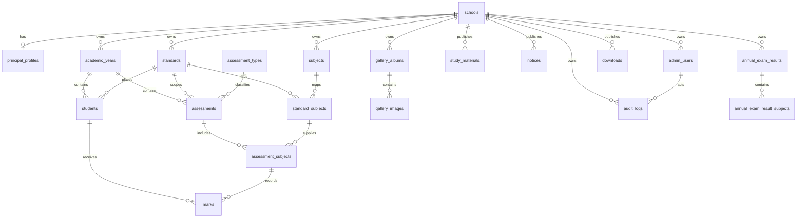

# Database Architecture — Rorfost School Platform

This document describes the implemented relational schema and future multi-tenant extensions. The only executable schema source is the Flyway migration directory:

```text
backend/src/main/resources/db/migration/
```

- Existing Flyway migrations: `V1` through `V24`.
- Migrations are strictly append-only; applied migrations are never edited.
- All domain identifiers are UUIDs, timestamps are `TIMESTAMPTZ`, and database naming follows `snake_case`.

## Multi-Tenant Strategy: As-Is vs. Target

### Current State (As-Is)
- Hosted on Aiven PostgreSQL.
- Single-school operational data.
- While tables carry `school_id` foreign keys, controllers frequently call first-active-school helpers (e.g. `SchoolRepository.findFirstByIsActiveTrueOrderByCreatedAtAsc()`).

### Target State (Planned Multi-Tenant Migration)
- Hosted on shared Neon PostgreSQL database (`school-platform-prod`).
- Flyway migrations will add:
  - `portal_gateway_credentials` (Sprint 03) — stores SHA-256 token digests, school IDs, and active status for Cloudflare Worker gateway authentication.
  - `school_features` (Sprint 16) — school-specific feature toggle overrides.
- Every repository query, join, and mutation must enforce `school_id` filtering from `TenantContext`.
- Global catalogs (such as `assessment_types`) remain shared; tenant-scoped records are strictly separated.

## Relationship Overview



## Implemented Tables (V1–V24)

| Table | Purpose and Multi-Tenant Isolation Rules |
|---|---|
| `schools` | School identity, URL slug, contact info, and branding. Slug and UUID are unique. |
| `principal_profiles` | One optional public principal profile per school (`school_id` unique). |
| `admin_users` | Principal credentials. Unique on `(school_id, email)`. BCrypt hashed passwords. Role `PRINCIPAL`. |
| `academic_years` | School-owned academic years. Partial unique index permits only one `CURRENT` year per school. |
| `standards` | Standards configured per school. Case-insensitively unique name per school. |
| `subjects` | Subjects configured per school. Uppercase code and unique name per school. |
| `standard_subjects` | Allowed standard/subject mapping. Both standard and subject must belong to the same school. |
| `students` | Minimum student identity: roll number, name, standard, year, archive state, BCrypt result-PIN hash. No Aadhaar. |
| `assessment_types` | Shared global catalog (`EKAM_KASOTI`, `UNIT_TEST`, `PERIODIC_TEST`, `SEMESTER`, `ANNUAL`, `OTHER`). |
| `assessments` | Generic assessments scoped to school, year, and standard. Lifecycle: `DRAFT`, `PUBLISHED`, `ARCHIVED`. |
| `assessment_subjects` | Subjects included in an assessment. |
| `marks` | Subject marks per student and assessment. Composite foreign keys enforce tenant consistency. |
| `annual_exam_results` | Multi-subject annual/ekam result rows scoped to `school_id` and result type. |
| `annual_exam_result_subjects` | Subject breakdown for exam results. |
| `study_materials` | Material metadata pointing to ImageKit objects. Scoped to `school_id`. |
| `notices` | School notices with optional ImageKit attachment metadata. Scoped to `school_id`. |
| `gallery_albums` | Photo albums with publication status and cover image. Scoped to `school_id`. |
| `gallery_images` | Ordered photos within an album. Scoped to album and `school_id`. |
| `downloads` | Official documents and timetable file metadata. Scoped to `school_id`. |
| `audit_logs` | Append-only administrative event logs. Scoped to `school_id`. |
| `site_visit_counters` | Counter tracking page visits. Scoped to `school_id`. |
| `spring_session` / `_attributes` | Spring Session JDBC tables in PostgreSQL. |

## Target Additions (Planned)

- `portal_gateway_credentials`: `(id, school_id, token_hash, name, is_active, created_at, revoked_at)`.
- `school_features`: `(id, school_id, feature_key, enabled, updated_at)`.

## Integrity Rules & Privacy

1. **Composite Foreign Keys:** Relationships enforce that child entities (e.g. students, marks, materials) belong to the same `school_id` as their parent containers.
2. **Deletion Safety:** Critical historical academic and result records use `ON DELETE RESTRICT`. Archiving is preferred over hard deletion.
3. **Privacy by Design:** Government identifiers (Aadhaar UID) are never accepted, hashed, or stored in the database. Result PINs are stored strictly as 60-character BCrypt hashes.
